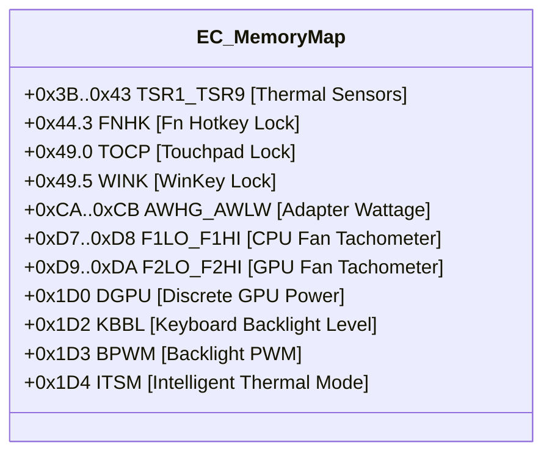

# Redmi G 2021 (A7 / XMCC1806) BIOS ACPI WMI (WMAA) 硬件接口逆向分析手册

> **文档版本**：v1.0.0 (Release)  
> **适用机型**：Redmi G 2021 锐龙版 / 小米游戏本 (模具代号：A7 / 英业达 XMCC1806 / Quanta 衍生)  
> **固件接口**：ACPI WMI 设备 `MICommonInterface` (`\._SB.PCI0.LPC0.H_EC`)  
> **分析依据**：提取自实体机 BIOS 运行态 ACPI 表 (`SSD5`、`DSDT`) AML 反汇编字节码与 `GamingBoxHost.exe` 逆向交叉印证

---

## 1. 接口通信规范总览

### 1.1 WMI 设备与调用拓扑

在 Windows 操作系统中，系统固件通过 ACPI WMI 驱动程序（`wmiacpi.sys`）将 Embedded Controller (EC) 与 BIOS 硬件控制例程暴露给应用层。应用层无需第三方私有驱动，即可直接通过系统原生 WMI 基础设施发起硬件调用。

- **WMI 命名空间**：`root\wmi`
- **WMI 类名**：`MICommonInterface`
- **ACPI 硬件 PNP ID**：`ACPI\PNP0C14\MIFS_0`
- **WMI 设备 GUID**：`{b60bfb48-3e5b-49e4-a0e9-8cffe1b3434b}`
- **ACPI `_WDG` 映射关系**：
  - `ObjectID`：`AA`
  - `Notify ID`：`0x01`
  - `Flags`：`0x02`（`WMI_METHOD`，指示此对象为执行方法）
- **底层 ACPI AML 处理函数**：`\_SB.PCI0.LPC0.H_EC.WMAA(Arg0, Arg1, Arg2)`
- **调用方法名**：`MiInterface`
- **系统权限要求**：**必须具备 Administrator（管理员）权限**（非管理员调用将抛出 HRESULT `0x80041003` / `Access Denied`）

---

### 1.2 内存字节布局规范

在执行 `MiInterface` 时，Windows WMI 引擎将入参结构作为二进制字节数组传递给 ACPI AML 解释器。

> [!IMPORTANT]
> **长度约束**：在 WMI MOF 类定义中，`InData` 参数受到 `[MAX(32)]` Qualifier 限定。传递超过 32 字节将触发 WMI 引擎抛出 `0x80041008` (Invalid Parameter)。因此，`InData` 必须严格定长为 **32 字节 (0x20)**。

#### InData (输入缓冲区，32 字节定长)

| 偏移量 (Offset) | 字段标识 | 数据类型 | 字节序 | 字段物理含义 |
| :--- | :--- | :--- | :--- | :--- |
| `0x00 ~ 0x01` | **`SGET`** | UInt16 | Little-Endian | 主命令分类（`0xFA00`: 读取/查询; `0xFB00`: 写入/设置） |
| `0x02 ~ 0x03` | **`FUNT`** | UInt16 | Little-Endian | 子命令功能编号（`0x0800`: 性能模式; `0x0900`: 风扇传感器; `0x0A00`: 外设锁; `0x0B00`: 显卡切换） |
| `0x04 ~ 0x05` | **`FND0`** | UInt16 | Little-Endian | 一级功能参数（控制时指定目标模式或外设 ID） |
| `0x06 ~ 0x09` | **`FND1`** | UInt32 | Little-Endian | 二级功能参数（外设控制开关状态：0=开, 1=关） |
| `0x0A ~ 0x0D` | **`FND2`** | UInt32 | Little-Endian | 三级扩展参数（保留预留，通常置 0） |
| `0x0E ~ 0x11` | **`FND3`** | UInt32 | Little-Endian | 四级扩展参数（保留预留，通常置 0） |
| `0x12 ~ 0x15` | **`FND4`** | UInt32 | Little-Endian | 五级扩展参数（保留预留，通常置 0） |
| `0x16 ~ 0x1F` | `Reserved`| Byte[10]| N/A | 填充字节（固定补 `0x00` 至 32 字节） |

#### OutData (输出缓冲区，30 ~ 33 字节)

固件执行完毕后，`WMAA` 返回一个 `Name (RETS, Buffer (0x21))` 命名缓冲区，在 WMI 中呈现为 30 ~ 33 字节的 Byte Array：

| 偏移量 (Offset) | 字段标识 | 数据类型 | 字节序 | 字段物理含义 |
| :--- | :--- | :--- | :--- | :--- |
| `0x00 ~ 0x01` | **`SGER`** | UInt16 | Little-Endian | 全局固件执行状态码（0x8000=成功，0xE000=拒绝） |
| `0x02 ~ 0x03` | **`FUTR`** | UInt16 | Little-Endian | 功能码回显（回显请求中的 `FUNT` 值） |
| `0x04 ~ 0x05` | **`FRD0`** | UInt16 | Little-Endian | 返回数据 0（模式查询结果 / CPU 风扇转速读数） |
| `0x06 ~ 0x09` | **`FRD1`** | UInt32 | Little-Endian | 返回数据 1（外设状态 / GPU 风扇转速读数） |
| `0x0A ~ 0x0D` | **`FRD2`** | UInt32 | Little-Endian | 返回数据 2（EC 传感器 TSR6 温度，摄氏度） |
| `0x0E ~ 0x11` | **`FRD3`** | UInt32 | Little-Endian | 返回数据 3（EC 传感器 TSR7 温度，摄氏度） |
| `0x12 ~ 0x15` | **`FRD4`** | UInt32 | Little-Endian | 返回数据 4（预留） |
| `0x16 ~ 0x1D` | `Padding` | Byte[8] | N/A | 尾部保留填充 |

---

### 1.3 全局返回状态码 (`SGER`) 判定逻辑

在 `OutData` 的前两个字节中，固件严格通过小端格式输出 16 位状态码：

- **`0x8000` (`[0x00, 0x80]`) - 执行成功 (SUCCESS)**：
  - 固件已成功匹配指令大类 `SGET` 与功能码 `FUNT`。
  - 所请求的 EC 寄存器已成功读取或已成功下发至硬件控制器。
- **`0xE000` (`[0x00, 0xE0]`) - 指令拒绝 / 无效参数 (REJECTED / INVALID_CMD)**：
  - 触发原因 1：`SGET` 非 `0xFA00` 或 `0xFB00`。
  - 触发原因 2：缓冲区中写入了 ASCII 文本字符串（如 `"FA00"`），而非小端二进制数值。
  - 触发原因 3：子功能编号 `FUNT` 超出范围，或 `FND0` 参数不在支持的枚举列表内。
- **`0x0000` (`[0x00, 0x00]`) - 固件未初始化 / 空应答**：
  - 通常在非管理员权限访问失败、或者 WMI 内部通信超时未收到 ACPI 应答时发生。

---

## 2. WMAA 全量指令分支速查表

以下表格完整枚举了 AML 方法 `WMAA` 内部的所有执行分支：

| 主命令 (SGET) | 子命令 (FUNT) | 读写属性 | 入参 (FND0 / FND1) 取值含义 | 出参 (FRD0 ~ FRD3) 格式与解码规则 | 关联 EC / 内部例程 | GamingBoxHost 常量名 | 功能详细说明 |
| :---: | :---: | :---: | :--- | :--- | :--- | :--- | :--- |
| `0xFA00` | `0x0800` | **Read** | `FND0 = 0` (忽略) | **`FRD0` (UInt16)**:<br>• `1`: 均衡模式 (Normal)<br>• `2`: 静谧模式 (Quiet)<br>• `3`: 极速模式 (Turbo) | `ECRD(ITSM)` | `gb_FAN_MD` | **查询当前性能模式**<br>通过读取 EC 寄存器 `ITSM` (0x1D4) 判断当前系统的电源与风扇配置策略。 |
| `0xFA00` | `0x0900` | **Read** | `FND0 = 0` (忽略) | **`FRD0` (UInt16)**: CPU 风扇转速<br>**`FRD1` (UInt32)**: GPU 风扇转速<br>**`FRD2` (UInt32)**: TSR6 温度 (°C)<br>**`FRD3` (UInt32)**: TSR7 温度 (°C) | `F1LO`, `F1HI`<br>`F2LO`, `F2HI`<br>`TSR6`, `TSR7` | `gb_FAN_SPED`<br>`gb_CPU_T`<br>`gb_GPU_T` | **查询硬件传感器与风扇**<br>一次性读取双风扇 Tachometer 转速（需注意固件小端反转）及两个主板 EC 热敏探针实时温度。 |
| `0xFA00` | `0x0A00` | **Read** | **`FND0` (外设类型)**:<br>• `0`: 触摸板 (Touchpad)<br>• `1`: Fn 键锁定 (Fn Lock)<br>• `2`: Win 键锁定 (WinLock) | **`FRD0` (UInt16)**: 回显外设类型<br>**`FRD1` (UInt32)**: 开关状态:<br>• `0`: 未锁定 (正常使能)<br>• `1`: 已锁定 (硬件禁用) | `TOCP`<br>`FNHK`<br>`WINK` | N/A (集成于热键模块) | **查询热键与设备锁定状态**<br>检查物理触摸板、Fn 快捷键切换状态、以及 Windows 徽标键的底层硬件屏蔽状态。 |
| `0xFA00` | `0x0B00` | **Read** | `FND0 = 0` (忽略) | **`FRD0` (UInt16)**:<br>• `1`: MSHybrid (混合输出)<br>• `0`: dGPU Direct (独显直连) | `DGDS` | N/A (未公开显示接口) | **查询显卡输出拓扑模式**<br>读取当前平台是处于核显+独显混合输出状态，还是处于独显硬件直连屏幕状态。 |
| `0xFB00` | `0x0800` | **Write** | **`FND0` (目标性能模式)**:<br>• `1`: 均衡模式 (Normal)<br>• `2`: 静谧模式 (Quiet)<br>• `3`: 极速模式 (Turbo)<br>• `0`: 自动动态分配 (Auto) | 成功时返回 `SGER = 0x8000`<br>`FUTR = 0x0800` | `ITSM`, `FNQS`<br>`AWHG`, `AWLW`<br>`WMID DEVBU` | `gb_FAN_MD` | **切换系统性能模式**<br>写入 EC `ITSM` 与 `FNQS` 寄存器，联动调节散热策略；同时触发 WMI 事件通知驱动层刷新功耗墙配置。 |
| `0xFB00` | `0x0A00` | **Write** | **`FND0` (外设类型)**: 0/1/2<br>**`FND1` (开关控制)**:<br>• `0`: 解锁 (使能设备)<br>• `1`: 锁定 (硬件屏蔽) | 成功时返回 `SGER = 0x8000`<br>`FRD0` 回显外设代号 | `TOCP`, `FNHK`<br>`WINK` (ECWT) | N/A (集成于热键模块) | **设置外设硬件屏蔽与锁**<br>硬件级别拦截 Windows 键、切断触摸板中断信号、或改变 Fn 组合键响应逻辑。 |
| `0xFB00` | `0x0B00` | **Trigger**| **`FND0` (显卡目标模式)**:<br>• `1`: 混合输出 (MSHybrid)<br>• `0`: 独显直连 (dGPU Direct) | 成功时返回 `SGER = 0x8000` | `SMBA`, `SMBB`<br>`WXMS` 例程 | N/A (隐藏直连开关) | **切换独显直连 / 混合模式**<br>通过 SMBus 写入 `0xD1` 控制指令并调用 `WXMS(0x41, 0xCC)` 触发硬件 MUX 芯片切换物理通道。 |

---

## 3. 底层 EC (Embedded Controller) 寄存器映射字典

所有与 `WMAA` 交互的底层硬件寄存器均位于 EC OperationRegion（`ECF2`，基址 `0xFED40000` 或 LPC 空间）：



### 3.1 核心寄存器定义详情

| EC 偏移地址 | 字段名称 | 宽度 (Bits) | 访问属性 | 物理含义与位定义说明 |
| :--- | :--- | :---: | :---: | :--- |
| `0x40` | **`TSR6`** | 8 | R | **主板/芯片核心温度传感器 6**<br>单位：摄氏度 (°C)。通常监测 GPU 核心或供电模块温度。 |
| `0x41` | **`TSR7`** | 8 | R | **辅板/外围环境温度传感器 7**<br>单位：摄氏度 (°C)。监测电池仓周围或机身进风口环境温度。 |
| `0x44 (bit 3)` | **`FNHK`** | 1 | R/W | **Fn 快捷键锁**<br>`0`: 组合键模式 (需按 Fn 触发 F1~F12 功能); `1`: 独立功能模式。 |
| `0x49 (bit 0)` | **`TOCP`** | 1 | R/W | **触摸板硬件开关**<br>`0`: 触摸板开启使能; `1`: 触摸板被物理切断禁用。 |
| `0x49 (bit 5)` | **`WINK`** | 1 | R/W | **Windows 键物理锁**<br>`0`: Win 键正常传输按键码; `1`: 屏蔽 Win 键信号（防游戏误触）。 |
| `0xCA` | **`AWHG`** | 8 | R | **电源适配器功率检测高字节** |
| `0xCB` | **`AWLW`** | 8 | R | **电源适配器功率检测低字节**<br>`(AWHG << 8) \| AWLW`：硬件实时协商的适配器额定功率（瓦特 W），如 180W / 230W / 100W PD。 |
| `0xD7` | **`F1LO`** | 8 | R | **CPU 风扇转速计低位字节** |
| `0xD8` | **`F1HI`** | 8 | R | **CPU 风扇转速计高位字节**<br>转速合成逻辑：`F1HI \| (F1LO << 8)`（注：若固件出现高低位颠倒，需按 16 位大端/小端自动修正）。 |
| `0xD9` | **`F2LO`** | 8 | R | **GPU 风扇转速计低位字节** |
| `0xDA` | **`F2HI`** | 8 | R | **GPU 风扇转速计高位字节**<br>转速合成逻辑：`F2HI \| (F2LO << 8)`。 |
| `0x1D0` | **`DGPU`** | 8 | R | **独立显卡供电与就绪状态**<br>`1`: dGPU 处于供电唤醒状态; `0`: dGPU 处于 D3Cold 挂起节能状态。 |
| `0x1D2` | **`KBBL`** | 8 | R/W | **键盘背光亮度等级**<br>`0x00`: 关闭背光; `0x01`: 弱光 (50%); `0x02`: 强光 (100%)。 |
| `0x1D3` | **`BPWM`** | 8 | R/W | **键盘/指示灯背光 PWM 频率占空比控制寄存器** |
| `0x1D4` | **`ITSM`** | 8 | R/W | **智能热管理与性能模式 (核心寄存器)**<br>• `0`: 均衡模式 (Normal)<br>• `1`: 极速满血模式 (Turbo / Fast)<br>• `2`: 静谧节能模式 (Quiet) |

---

## 4. 隐藏功能与未公开接口挖掘

### 4.1 硬件级显卡 MUX 切换 (`0x0B00`)

在小米官方游戏盒子（GamingBox）的前端 UI 中，部分锐龙机型并未开放直观的独显直连/混合输出切换开关，但在 BIOS WMAA 中该指令已完全就绪：

```asl
// SSD5 AML 源码片段 (0x1a20):
If (LEqual (_T_5, 0x0B00)) {
    Store (0x8000, SGER)
    Store (ToInteger (FND0), _T_6)
    If (LEqual (_T_6, 0x01)) {
        Store (0xD1, SMBA)
        Store (0x21, SMBB)  // 切换为 MSHybrid 混合输出
    } Else {
        Store (0xD1, SMBA)
        WXMS (0x41, 0xCC)   // 下发硬件切换命令
        Store (0x22, SMBB)  // 切换为 dGPU Direct 独显直连
    }
}
```

> [!WARNING]
> **风险提示**：
> 1. 下发独显直连指令后，由于显示总线通道切换，屏幕可能会出现短暂黑屏闪烁。
> 2. 部分 BIOS 版本需要冷重启（Cold Reboot）后，EDID 与物理通道才会彻底完成重新枚举。在 Windows 运行态下强制下发可能导致显卡驱动崩溃（TDR）。

### 4.2 电源适配器功率限制与功耗墙联动

在模式切换指令 `0xFB00, 0x0800` 的子流程中，AML 引擎会读取 EC 寄存器 `AWHG` 和 `AWLW`：
- 若检测到当前插入的不是原装高功率 DC 适配器（例如使用的是 Type-C 65W/100W PD 充电器），固件会自动限制极速模式的生效，强制回退至 `EWL4`（低功耗限制），以防止电池过放或充电器过流保护。

### 4.3 物理防误触锁 (`0x0A00`)

WMAA 提供了完备的键盘与触摸板拦截开关：
- 下发 `SGET=0xFB00, FUNT=0x0A00, FND0=0x0002, FND1=0x0001` 可以无需任何按键映射软件，从硬件控制器层彻底屏蔽 Windows 徽标键的扫描码输出，适合集成在全屏游戏脚本中自动启闭。

---

## 5. 最小可复现调用示例（Python & PowerShell）

### 5.1 PowerShell 最小调用模板

```powershell
function Invoke-RedmiGWMAA {
    <#
    .SYNOPSIS
        向 Redmi G / 小米游戏本 ACPI WMAA 下发二进制指令
    .EXAMPLE
        Invoke-RedmiGWMAA -SGet 0xFA00 -Funt 0x0800 # 查询性能模式
        Invoke-RedmiGWMAA -SGet 0xFB00 -Funt 0x0800 -Fnd0 1 # 切换为均衡模式
        Invoke-RedmiGWMAA -SGet 0xFA00 -Funt 0x0900 # 读取风扇转速
    #>
    param(
        [Parameter(Mandatory = $true)][uint16]$SGet,
        [Parameter(Mandatory = $true)][uint16]$Funt,
        [Parameter()][uint16]$Fnd0 = 0,
        [Parameter()][uint32]$Fnd1 = 0
    )

    # 1. 严格构造 32 字节 Little-Endian 输入缓冲区
    $inData = New-Object byte[] 32
    $inData[0] = [byte]($SGet -band 0xFF)
    $inData[1] = [byte](($SGet -shr 8) -band 0xFF)
    $inData[2] = [byte]($Funt -band 0xFF)
    $inData[3] = [byte](($Funt -shr 8) -band 0xFF)
    $inData[4] = [byte]($Fnd0 -band 0xFF)
    $inData[5] = [byte](($Fnd0 -shr 8) -band 0xFF)
    $inData[6] = [byte]($Fnd1 -band 0xFF)
    $inData[7] = [byte](($Fnd1 -shr 8) -band 0xFF)
    $inData[8] = [byte](($Fnd1 -shr 16) -band 0xFF)
    $inData[9] = [byte](($Fnd1 -shr 24) -band 0xFF)

    # 2. 调用 WMI MICommonInterface
    try {
        $inst = Get-CimInstance -Namespace "root\wmi" -ClassName "MICommonInterface" -ErrorAction Stop
        $res = Invoke-CimMethod -InputObject $inst -MethodName "MiInterface" -Arguments @{ InData = $inData } -ErrorAction Stop
    } catch {
        Write-Error "WMI 访问失败（请确认是否以管理员身份运行）: $($_.Exception.Message)"
        return $null
    }

    $out = $res.OutData
    if (-not $out -or $out.Length -lt 6) { return $null }

    # 3. 解码出参结构
    $sger = [BitConverter]::ToUInt16($out, 0)
    $futr = [BitConverter]::ToUInt16($out, 2)
    $frd0 = [BitConverter]::ToUInt16($out, 4)
    $frd1 = if ($out.Length -ge 10) { [BitConverter]::ToUInt32($out, 6) } else { 0 }
    $frd2 = if ($out.Length -ge 14) { [BitConverter]::ToUInt32($out, 10) } else { 0 }
    $frd3 = if ($out.Length -ge 18) { [BitConverter]::ToUInt32($out, 14) } else { 0 }

    return [PSCustomObject]@{
        Success = ($sger -eq 0x8000)
        Status  = "0x{0:X4}" -f $sger
        FUTR    = "0x{0:X4}" -f $futr
        FRD0    = $frd0
        FRD1    = $frd1
        FRD2    = $frd2
        FRD3    = $frd3
        RawOut  = $out
    }
}
```

---

### 5.2 Python 最小调用模板 (无三方包依赖)

```python
import subprocess
from typing import Optional, Dict, Any

def invoke_redmig_wmaa(sget: int, funt: int, fnd0: int = 0, fnd1: int = 0) -> Optional[Dict[str, Any]]:
    """
    跨平台/无外部库依赖调用 Redmi G ACPI WMAA 硬件接口
    
    :param sget: 主命令大类 (如 0xFA00 查, 0xFB00 写)
    :param funt: 子命令编号 (如 0x0800 模式, 0x0900 风扇)
    :param fnd0: 一级参数
    :param fnd1: 二级参数
    :return: 解析后的字典对象
    """
    # 构造 32 字节定长 InData
    in_buf = bytearray(32)
    in_buf[0:2] = sget.to_bytes(2, byteorder='little')
    in_buf[2:4] = funt.to_bytes(2, byteorder='little')
    in_buf[4:6] = fnd0.to_bytes(2, byteorder='little')
    in_buf[6:10] = fnd1.to_bytes(4, byteorder='little')

    byte_list_str = ', '.join(f"0x{b:02X}" for b in in_buf)
    ps_script = (
        f"$in = [byte[]]({byte_list_str}); "
        f"$inst = Get-CimInstance -Namespace 'root\\wmi' -ClassName 'MICommonInterface' -ErrorAction Stop; "
        f"$res = Invoke-CimMethod -InputObject $inst -MethodName 'MiInterface' -Arguments @{{ InData = $in }}; "
        f"$hex = ($res.OutData | ForEach-Object {{ '{{0:X2}}' -f $_ }}) -join ' '; "
        f"Write-Output \"HEX:$hex\""
    )

    try:
        proc = subprocess.run(
            ["powershell", "-NoProfile", "-Command", ps_script],
            capture_output=True,
            text=True,
            check=True
        )
        for line in proc.stdout.splitlines():
            if line.startswith("HEX:"):
                hex_str = line.replace("HEX:", "").strip()
                out_bytes = bytes.fromhex(hex_str.replace(" ", ""))
                if len(out_bytes) < 6:
                    return None
                
                sger = int.from_bytes(out_bytes[0:2], byteorder='little')
                futr = int.from_bytes(out_bytes[2:4], byteorder='little')
                frd0 = int.from_bytes(out_bytes[4:6], byteorder='little')
                frd1 = int.from_bytes(out_bytes[6:10], byteorder='little') if len(out_bytes) >= 10 else 0
                frd2 = int.from_bytes(out_bytes[10:14], byteorder='little') if len(out_bytes) >= 14 else 0
                frd3 = int.from_bytes(out_bytes[14:18], byteorder='little') if len(out_bytes) >= 18 else 0

                return {
                    "success": (sger == 0x8000),
                    "status_code": hex(sger),
                    "futr": hex(futr),
                    "frd0": frd0,
                    "frd1": frd1,
                    "frd2": frd2,
                    "frd3": frd3,
                    "raw_hex": out_bytes.hex().upper()
                }
    except Exception as e:
        print(f"[ERROR] 执行失败（请确保已具备管理员权限）: {e}")
        return None

# ================= 使用示例 =================
if __name__ == "__main__":
    # 示例 1: 查询当前性能模式
    mode_res = invoke_redmig_wmaa(sget=0xFA00, funt=0x0800)
    print("模式查询结果:", mode_res)

    # 示例 2: 查询风扇与温度
    fan_res = invoke_redmig_wmaa(sget=0xFA00, funt=0x0900)
    print("风扇传感器结果:", fan_res)
```
